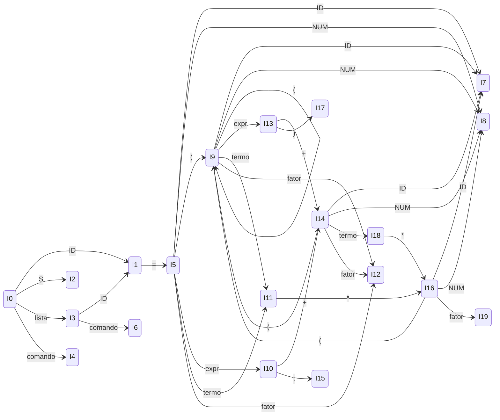
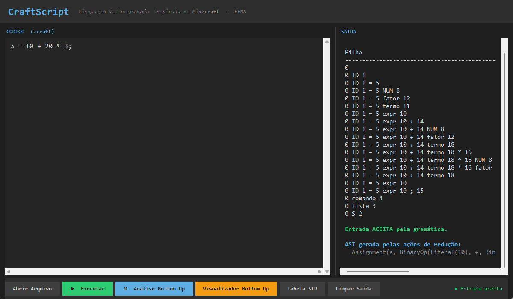
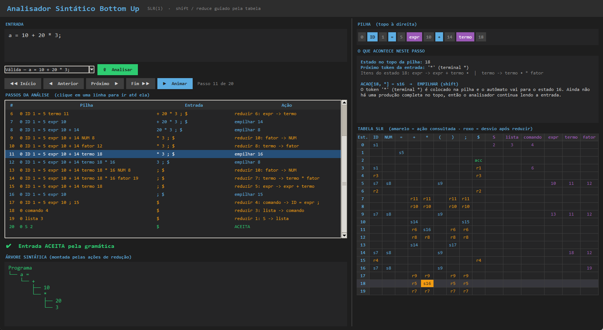
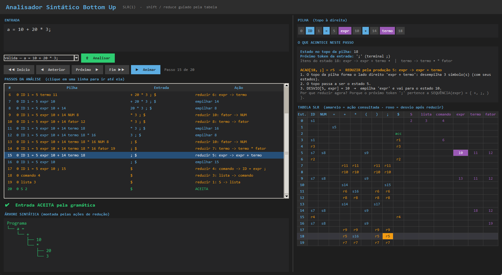
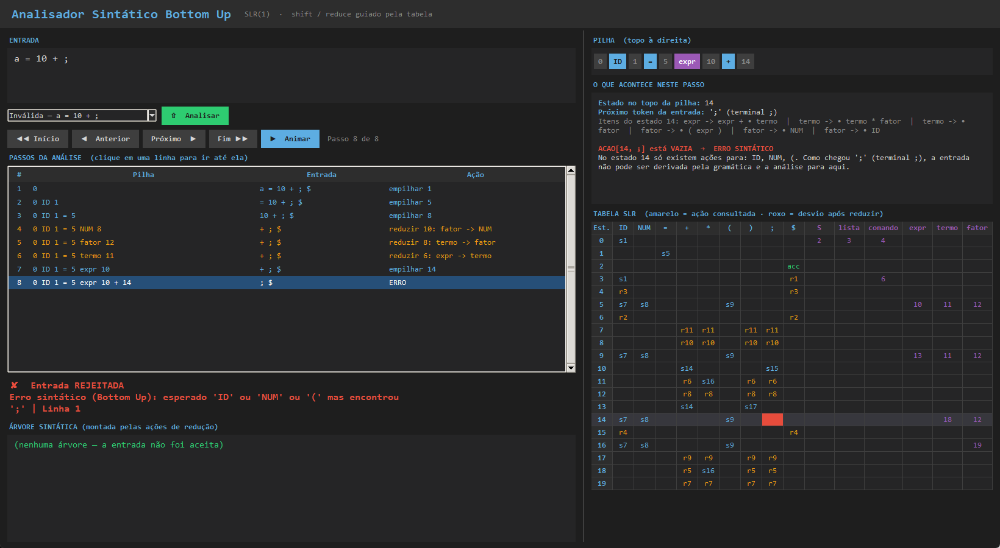

# Análise Sintática Bottom Up — Guia Completo

**Projeto CraftScript · Compiladores · Parte II**

Este guia explica tudo o que foi feito na Parte II do trabalho: o que é a análise sintática, por que existe o método Bottom Up, como a tabela SLR foi construída, como o analisador usa essa tabela, como isso aparece no código e na interface, e como apresentar ao professor.

---

## Sumário

1. Visão geral: onde a análise sintática entra
2. O que o trabalho pede e o que foi entregue
3. A gramática, regra por regra
4. Top Down × Bottom Up
5. Os conceitos do Bottom Up: pilha, empilhar, reduzir, *handle*
6. Itens LR(0) e o Autômato Finito Determinístico
7. Conjuntos Primeiro e Sequência
8. Construção da tabela SLR
9. O algoritmo do analisador
10. Exemplo completo, passo a passo e comentado
11. Ações semânticas: a árvore sintática
12. Erros sintáticos
13. Como está implementado no código
14. A interface gráfica
15. Como executar
16. Roteiro de apresentação
17. Perguntas que o professor pode fazer
18. Glossário

---

## 1. Visão geral: onde a análise sintática entra

Um compilador lê um programa em **fases**. Cada fase recebe o resultado da anterior:

```
 código-fonte  ──►  LÉXICO  ──►  tokens  ──►  SINTÁTICO  ──►  árvore sintática  ──►  semântico / execução
 "a = 10+20*3;"     (Parte I)    ID = NUM      (Parte II)      a = (10 + (20*3))
                                 + NUM * NUM ;
```

| Fase | Pergunta que responde | Exemplo de erro que detecta |
|---|---|---|
| **Léxica** | "Cada pedaço do texto é uma palavra válida da linguagem?" | `a = 5@;` → o caractere `@` não existe na linguagem |
| **Sintática** | "As palavras estão numa **ordem** permitida pela gramática?" | `a = 10 + ;` → todas as palavras existem, mas falta algo depois do `+` |

**Analogia com o português:** o léxico confere se as *palavras* existem no dicionário; o sintático confere se a *frase* está montada corretamente. "Gato o comeu peixe o" tem só palavras válidas, mas a frase está errada — isso é um erro **sintático**.

O analisador léxico foi feito no 1º semestre (`lexer/lexer.py`). A Parte II acrescenta o **analisador sintático Bottom Up**, que recebe os tokens do léxico e decide se a entrada é **aceita** ou **rejeitada** pela gramática.

---

## 2. O que o trabalho pede e o que foi entregue

| Pedido no enunciado | Onde está |
|---|---|
| Implementar o analisador sintático, verificando se a entrada é aceita pela gramática | `parser/parser_bottom_up.py` (e o parser descendente original `parser/parser.py`) |
| O compilador deve fazer a análise léxica **e** a sintática | O Bottom Up consome os tokens do `Lexer` da Parte I |
| Implementar a análise **Bottom Up** com base na gramática dada | Analisador SLR(1) com a gramática do enunciado |
| Construir a **tabela de análise sintática Bottom Up** e usá-la para analisar | Tabelas `ACAO` e `DESVIO` no código; o algoritmo só consulta a tabela |
| Implementar as **ações** do analisador | Empilhar, reduzir, aceitar, erro + ações semânticas que montam a árvore |
| Apresentar uma entrada válida e uma inválida | `bottomup_valido.craft`, `bottomup_invalido.craft` e exemplos na interface |
| Documento: gramática, AFD de itens, Primeiro e Sequência, tabela | Seções 3, 6, 7 e 8 deste guia (e `docs/parte2_analise_sintatica.pdf`) |

---

## 3. A gramática, regra por regra

A gramática é o conjunto de **regras** que define quais sequências de tokens formam um programa válido. Usamos a gramática do enunciado, **aumentada** com uma regra inicial `S' → S`:

| Nº | Produção | Significado |
|---|---|---|
| 0 | S' → S | Regra artificial de início (explicada abaixo) |
| 1 | S → lista | Um programa é uma lista de comandos |
| 2 | lista → lista comando | Uma lista pode crescer com mais um comando… |
| 3 | lista → comando | …ou ser um único comando |
| 4 | comando → ID = expr ; | Um comando é uma atribuição: `a = ... ;` |
| 5 | expr → expr + termo | Uma expressão é uma soma… |
| 6 | expr → termo | …ou simplesmente um termo |
| 7 | termo → termo * fator | Um termo é uma multiplicação… |
| 8 | termo → fator | …ou simplesmente um fator |
| 9 | fator → ( expr ) | Um fator pode ser uma expressão entre parênteses… |
| 10 | fator → NUM | …um número… |
| 11 | fator → ID | …ou uma variável |

**Terminais** (os tokens, aquilo que aparece no texto): `ID`, `NUM`, `=`, `+`, `*`, `(`, `)`, `;` e `$` (marca de fim da entrada).
**Não terminais** (as "categorias" gramaticais): `S'`, `S`, `lista`, `comando`, `expr`, `termo`, `fator`.

### Por que três níveis (`expr`, `termo`, `fator`)?

É assim que a gramática codifica a **precedência** dos operadores. Quanto mais "fundo" o nível, mais forte o operador:

```
expr   ──  soma   (+)   ← nível mais fraco, resolvido por último
termo  ──  multiplicação (*)
fator  ──  número, variável, ( ... )   ← nível mais forte
```

Como uma `expr` é feita de `termo`s, e um `termo` é feito de `fator`s, a multiplicação sempre fica "dentro" da soma. Por isso `10 + 20 * 3` só pode ser lido como `10 + (20 * 3)`.

### Por que as regras são recursivas à esquerda?

Regras como `expr → expr + termo` têm o próprio `expr` como **primeiro** símbolo do lado direito (recursão à esquerda). Isso faz as operações serem **associativas à esquerda**: `1 + 2 + 3` vira `(1 + 2) + 3`, que é o comportamento matemático correto. Um parser descendente simples entraria em laço infinito com esse tipo de regra; o Bottom Up lida com ela sem nenhum problema.

### Por que a regra `S' → S`?

É a **gramática aumentada**. Ela cria um único ponto de chegada: quando o analisador consegue formar `S'` (ou seja, reduzir tudo até `S` e a entrada acabar), sabe que **terminou e deve aceitar**. Sem ela, não haveria um momento claro de "aceitar".

### Ligação com o léxico da Parte I

O `Lexer` gera tokens do tipo `TokenType`. O analisador converte cada um para o terminal da gramática:

| Token do Lexer | Terminal |
|---|---|
| `ID` | ID |
| `INT`, `FLOAT` | NUM |
| `ATRIB` | = |
| `MAIS` | + |
| `MULT` | * |
| `ABRE_PAR`, `FECHA_PAR` | ( e ) |
| `PONTO_VIRG` | ; |
| `EOF` | $ |

Qualquer outro token (por exemplo `bloco`, `-`, `mostrar`) não pertence a esta gramática e é tratado como erro sintático.

---

## 4. Top Down × Bottom Up

Existem duas grandes famílias de analisadores sintáticos:

| | **Top Down** (descendente) | **Bottom Up** (ascendente) |
|---|---|---|
| Direção | Começa pelo símbolo inicial `S` e desce até os tokens | Começa pelos tokens e sobe até o símbolo inicial `S` |
| Pergunta em cada passo | "Qual regra devo **expandir** agora?" | "Devo **empilhar** mais um token ou **reduzir** o que já tenho?" |
| Como decide | Funções recursivas, uma por regra (no nosso caso, `parser/parser.py`) | Uma **tabela** de ações (`ACAO` / `DESVIO`) |
| Recursão à esquerda | Não funciona (laço infinito) | Funciona normalmente |
| Exemplos de uso | Parsers escritos à mão | Geradores de compiladores: **Yacc**, **Bison** |

Visualmente, para `a = 10 + 20 * 3;`:

```
TOP DOWN  (de cima para baixo)          BOTTOM UP  (de baixo para cima)

        S                                 a  =  10  +  20  *  3  ;
        │                                 │      │      │      │
      lista                              ID     NUM    NUM    NUM
        │                                        │      │      │
     comando                                   fator  fator  fator
    ┌──┬─┴──┬───┐                              │      └──┬───┘
    ID =  expr  ;                             termo    termo
          ...                                  │         │
                                              expr ──────┘
     ▼ expande regras                           │   (expr + termo → expr)
                                             comando
                                                │
                                              lista
                                                │
                                                S       ▲ reduz até o topo
```

**Por que o professor pede o Bottom Up?** Porque ele é o método usado pelos compiladores reais (via Yacc/Bison), aceita uma classe maior de gramáticas (inclusive as recursivas à esquerda) e é **guiado por tabela** — a parte central da teoria de compiladores: a tabela é construída matematicamente a partir da gramática, e o algoritmo é sempre o mesmo, qualquer que seja a gramática.

---

## 5. Os conceitos do Bottom Up: pilha, empilhar, reduzir, *handle*

O analisador trabalha com duas estruturas:

- **Pilha:** guarda o que já foi lido e parcialmente reconhecido.
- **Entrada:** os tokens que ainda faltam ler, terminando com `$`.

Em cada passo ele toma **uma** das quatro ações:

| Ação | Na tabela | O que faz |
|---|---|---|
| **Empilhar** (*shift*) | `sN` | Tira o próximo token da entrada, coloca na pilha e vai para o estado N |
| **Reduzir** (*reduce*) | `rN` | O topo da pilha forma o lado direito da regra N: troca esses símbolos pelo lado esquerdo |
| **Aceitar** | `acc` | Chegou ao símbolo inicial com a entrada vazia: programa correto |
| **Erro** | célula vazia | Nenhuma ação é possível: programa incorreto |

**Handle** é o nome técnico do trecho do topo da pilha que corresponde ao lado direito de uma regra e que *deve* ser reduzido naquele momento. Toda a dificuldade do Bottom Up é saber **quando** o topo da pilha é um handle — e é exatamente isso que a tabela responde.

**Curiosidade teórica:** a sequência de reduções do Bottom Up é a **derivação mais à direita lida de trás para frente**. Por isso esses analisadores se chamam **LR**: lêem a entrada da esquerda para a direita (**L**, *left-to-right*) e produzem uma derivação mais à direita (**R**, *rightmost*) ao contrário.

---

## 6. Itens LR(0) e o Autômato Finito Determinístico

### O que é um item

Para decidir entre empilhar e reduzir, o analisador precisa saber **em que ponto de qual regra ele está**. Um **item** é uma regra com um ponto `•` indicando quanto dela já foi reconhecido:

| Item | Leitura |
|---|---|
| `comando → • ID = expr ;` | "Ainda não li nada deste comando; espero um ID" |
| `comando → ID = • expr ;` | "Já li `ID =`; agora espero uma expressão" |
| `comando → ID = expr ; •` | "Li o comando inteiro: posso **reduzir**" |

Um item com o ponto no final (`A → α •`) é um **item completo** e indica uma possível redução.

### Fechamento (*closure*)

Se o ponto está antes de um **não terminal**, o analisador também precisa estar pronto para começar a reconhecer esse não terminal. Exemplo: em `comando → ID = • expr ;`, o próximo símbolo esperado é `expr`; então acrescentamos todos os itens que começam uma `expr`:

```
comando → ID = • expr ;
expr  → • expr + termo        ← porque o ponto está antes de expr
expr  → • termo
termo → • termo * fator       ← porque agora o ponto está antes de termo
termo → • fator
fator → • ( expr )            ← porque agora o ponto está antes de fator
fator → • NUM
fator → • ID
```

Esse conjunto inteiro é o **estado I5**.

### Desvio (*goto*)

De um estado, "lendo" um símbolo X, vamos para o estado formado pelos itens em que o ponto pula por cima de X (e depois aplicamos o fechamento). Exemplo: de I5, lendo `termo`, os itens `expr → • termo` e `termo → • termo * fator` viram `expr → termo •` e `termo → termo • * fator` — esse é o **estado I11**.

### Os 20 estados

Começando de `I0 = fechamento(S' → • S)` e aplicando o desvio com todos os símbolos possíveis até não surgirem estados novos, obtemos 20 estados:

| Estado | Itens | O que significa |
|---|---|---|
| **I0** | S' → •S · S → •lista · lista → •lista comando · lista → •comando · comando → •ID = expr ; | Início: espera o primeiro comando |
| **I1** | comando → ID •= expr ; | Leu o nome da variável, espera `=` |
| **I2** | S' → S• | Reconheceu o programa inteiro: **aceitar** |
| **I3** | S → lista• · lista → lista •comando · comando → •ID = expr ; | Já tem uma lista; pode acabar ou vir outro comando |
| **I4** | lista → comando• | Primeiro comando completo |
| **I5** | comando → ID = •expr ; + itens de expr, termo, fator | Leu `ID =`, espera a expressão |
| **I6** | lista → lista comando• | Mais um comando acrescentado à lista |
| **I7** | fator → ID• | Leu uma variável dentro da expressão |
| **I8** | fator → NUM• | Leu um número |
| **I9** | fator → ( •expr ) + itens de expr, termo, fator | Abriu parênteses, espera expressão |
| **I10** | comando → ID = expr •; · expr → expr •+ termo | Tem uma expressão: pode vir `;` ou `+` |
| **I11** | expr → termo• · termo → termo •* fator | Tem um termo: reduzir para expr **ou** continuar com `*` |
| **I12** | termo → fator• | Fator vira termo |
| **I13** | fator → ( expr •) · expr → expr •+ termo | Expressão dentro de parênteses: espera `)` ou `+` |
| **I14** | expr → expr + •termo + itens de termo, fator | Leu `+`, espera o termo da direita |
| **I15** | comando → ID = expr ; • | Comando completo |
| **I16** | termo → termo * •fator + itens de fator | Leu `*`, espera o fator da direita |
| **I17** | fator → ( expr )• | Parênteses fechados |
| **I18** | expr → expr + termo• · termo → termo •* fator | Soma completa, **ou** continua com `*` |
| **I19** | termo → termo * fator• | Multiplicação completa |

### O autômato (AFD de itens)

Os estados e as transições formam um **Autômato Finito Determinístico**. As setas com terminais viram ações de *empilhar*; as setas com não terminais viram a parte de *desvio* da tabela.



**Como ler:** partindo de I0, o caminho `ID → = → NUM` leva a I1, I5 e I8 — exatamente o que acontece ao ler `a = 10`. Os estados de I5, I9, I14 e I16 compartilham destinos (I7, I8, I9) porque todos estão esperando um `fator`.

---

## 7. Conjuntos Primeiro e Sequência

| Não terminal | PRIMEIRO | SEQUÊNCIA |
|---|---|---|
| S' | { ID } | { $ } |
| S | { ID } | { $ } |
| lista | { ID } | { ID, $ } |
| comando | { ID } | { ID, $ } |
| expr | { (, NUM, ID } | { +, ;, ) } |
| termo | { (, NUM, ID } | { +, *, ;, ) } |
| fator | { (, NUM, ID } | { +, *, ;, ) } |

### PRIMEIRO(X): com que tokens X pode começar

- `fator` começa com `(`, `NUM` ou `ID` (regras 9, 10, 11).
- `termo → fator`, então PRIMEIRO(termo) inclui PRIMEIRO(fator). O mesmo vale para `expr → termo`.
- `comando` sempre começa com `ID` (regra 4). Como `lista` começa com `comando`, e `S` com `lista`, todos começam com `ID`.

### SEQUÊNCIA(X): que tokens podem vir logo depois de X

Regras de cálculo: (1) `$` está na SEQUÊNCIA do símbolo inicial; (2) em `A → α X β`, tudo de PRIMEIRO(β) entra em SEQUÊNCIA(X); (3) em `A → α X` (X no final), tudo de SEQUÊNCIA(A) entra em SEQUÊNCIA(X).

- SEQ(S') = { $ } pela regra (1); passa para `S` (regra 0) e para `lista` (regra 1).
- Na regra 2, `lista` é seguida de `comando`, então PRIMEIRO(comando) = { ID } entra em SEQ(lista) → { ID, $ }.
- `comando` aparece no final de `lista` (regras 2 e 3) → SEQ(comando) = SEQ(lista) = { ID, $ }.
- `expr` é seguida por `;` (regra 4), `+` (regra 5) e `)` (regra 9) → { +, ;, ) }.
- `termo` está no final de `expr` (regras 5 e 6), herda { +, ;, ) }, e é seguido por `*` na regra 7 → { +, *, ;, ) }.
- `fator` está no final de `termo` (regras 7 e 8) → herda { +, *, ;, ) }.

### Para que servem

A **SEQUÊNCIA** é o que torna o analisador **SLR** (*Simple LR*): ele só reduz por `A → α` se o próximo token estiver em SEQUÊNCIA(A). Isso resolve as dúvidas entre empilhar e reduzir — ver a próxima seção.

---

## 8. Construção da tabela SLR

### Regras de preenchimento

Para cada estado Ii:

1. **Empilhar:** se há transição de Ii para Ij com um terminal `a`, então `ACAO[i, a] = sj`.
2. **Desvio:** se há transição de Ii para Ij com um não terminal `A`, então `DESVIO[i, A] = j`.
3. **Reduzir:** se Ii tem o item completo `A → α •` (regra N), então `ACAO[i, a] = rN` **para cada `a` em SEQUÊNCIA(A)**.
4. **Aceitar:** se Ii tem `S' → S •`, então `ACAO[i, $] = acc`.
5. Tudo o que sobrar vazio é **erro**.

### A tabela

| Estado | ID | NUM | = | + | * | ( | ) | ; | $ | S | lista | comando | expr | termo | fator |
|---|---|---|---|---|---|---|---|---|---|---|---|---|---|---|---|
| 0 | s1 | | | | | | | | | 2 | 3 | 4 | | | |
| 1 | | | s5 | | | | | | | | | | | | |
| 2 | | | | | | | | | acc | | | | | | |
| 3 | s1 | | | | | | | | r1 | | | 6 | | | |
| 4 | r3 | | | | | | | | r3 | | | | | | |
| 5 | s7 | s8 | | | | s9 | | | | | | | 10 | 11 | 12 |
| 6 | r2 | | | | | | | | r2 | | | | | | |
| 7 | | | | r11 | r11 | | r11 | r11 | | | | | | | |
| 8 | | | | r10 | r10 | | r10 | r10 | | | | | | | |
| 9 | s7 | s8 | | | | s9 | | | | | | | 13 | 11 | 12 |
| 10 | | | | s14 | | | | s15 | | | | | | | |
| 11 | | | | r6 | s16 | | r6 | r6 | | | | | | | |
| 12 | | | | r8 | r8 | | r8 | r8 | | | | | | | |
| 13 | | | | s14 | | | s17 | | | | | | | | |
| 14 | s7 | s8 | | | | s9 | | | | | | | | 18 | 12 |
| 15 | r4 | | | | | | | | r4 | | | | | | |
| 16 | s7 | s8 | | | | s9 | | | | | | | | | 19 |
| 17 | | | | r9 | r9 | | r9 | r9 | | | | | | | |
| 18 | | | | r5 | s16 | | r5 | r5 | | | | | | | |
| 19 | | | | r7 | r7 | | r7 | r7 | | | | | | | |

**Como ler uma célula:** linha 11, coluna `*` = `s16` → "no estado 11, se o próximo token for `*`, empilhe e vá para o estado 16". Linha 11, coluna `+` = `r6` → "no estado 11, se vier `+`, reduza pela regra 6 (`expr → termo`)".

### Por que SLR e não LR(0)?

Num analisador **LR(0)**, um item completo manda reduzir **com qualquer token**. Três estados teriam **conflito** (duas ações na mesma célula):

| Estado | Itens em disputa | Conflito no LR(0) | Como o SLR resolve |
|---|---|---|---|
| I3 | `S → lista •` e `comando → • ID ...` | reduzir r1 **ou** empilhar ID? | r1 só em SEQ(S) = { $ }; ID não está lá → empilha |
| I11 | `expr → termo •` e `termo → termo • * fator` | reduzir r6 **ou** empilhar `*`? | r6 só em SEQ(expr) = { +, ;, ) }; `*` não está lá → empilha |
| I18 | `expr → expr + termo •` e `termo → termo • * fator` | reduzir r5 **ou** empilhar `*`? | r5 só em SEQ(expr); `*` não está lá → empilha |

Com a SEQUÊNCIA, **nenhuma célula tem duas ações**, então a gramática é **SLR(1)**. Os estados I11 e I18 são justamente onde a **precedência** do `*` sobre o `+` é decidida.

---

## 9. O algoritmo do analisador

O algoritmo é sempre o mesmo, qualquer que seja a gramática — toda a "inteligência" está na tabela:

```
pilha ← [0]
a ← primeiro token da entrada

repita:
    s ← estado no topo da pilha
    se ACAO[s, a] = empilhar j:
        empilha a e o estado j
        a ← próximo token
    senão se ACAO[s, a] = reduzir pela regra  A → β:
        desempilha |β| símbolos (e seus estados)
        t ← estado que ficou no topo
        empilha A e o estado DESVIO[t, A]
        executa a ação semântica da regra (monta a árvore)
    senão se ACAO[s, a] = aceitar:
        ACEITA — fim
    senão:
        ERRO — informa os tokens esperados no estado s
```

---

## 10. Exemplo completo, passo a passo e comentado

Entrada: `a = 10 + 20 * 3;` → tokens `ID = NUM + NUM * NUM ; $`

| # | Pilha | Entrada | Ação | Comentário |
|---|---|---|---|---|
| 1 | 0 | a = 10 + 20 * 3 ; $ | empilhar 1 | ACAO[0, ID] = s1 |
| 2 | 0 ID 1 | = 10 + 20 * 3 ; $ | empilhar 5 | Leu a variável, agora o `=` |
| 3 | 0 ID 1 = 5 | 10 + 20 * 3 ; $ | empilhar 8 | Começa a expressão |
| 4 | 0 ID 1 = 5 NUM 8 | + 20 * 3 ; $ | reduzir 10: fator → NUM | `+` ∈ SEQ(fator) |
| 5 | 0 ID 1 = 5 fator 12 | + 20 * 3 ; $ | reduzir 8: termo → fator | |
| 6 | 0 ID 1 = 5 termo 11 | + 20 * 3 ; $ | reduzir 6: expr → termo | `+` ∈ SEQ(expr) |
| 7 | 0 ID 1 = 5 expr 10 | + 20 * 3 ; $ | empilhar 14 | |
| 8 | 0 ID 1 = 5 expr 10 + 14 | 20 * 3 ; $ | empilhar 8 | |
| 9 | … + 14 NUM 8 | * 3 ; $ | reduzir 10: fator → NUM | |
| 10 | … + 14 fator 12 | * 3 ; $ | reduzir 8: termo → fator | |
| 11 | … + 14 termo 18 | * 3 ; $ | **empilhar 16** | **Momento-chave:** a soma `expr + termo` está pronta, mas vem `*`. Como `*` ∉ SEQ(expr), a tabela manda empilhar: a multiplicação será feita primeiro |
| 12 | … termo 18 * 16 | 3 ; $ | empilhar 8 | |
| 13 | … * 16 NUM 8 | ; $ | reduzir 10: fator → NUM | |
| 14 | … termo 18 * 16 fator 19 | ; $ | reduzir 7: termo → termo * fator | **Multiplicou** 20 * 3 |
| 15 | … expr 10 + 14 termo 18 | ; $ | reduzir 5: expr → expr + termo | Agora sim, `;` ∈ SEQ(expr): **somou** 10 + (20*3) |
| 16 | 0 ID 1 = 5 expr 10 | ; $ | empilhar 15 | |
| 17 | 0 ID 1 = 5 expr 10 ; 15 | $ | reduzir 4: comando → ID = expr ; | Comando completo |
| 18 | 0 comando 4 | $ | reduzir 3: lista → comando | |
| 19 | 0 lista 3 | $ | reduzir 1: S → lista | |
| 20 | 0 S 2 | $ | **ACEITA** | ACAO[2, $] = acc |

O passo 11 é o que vale a pena mostrar ao professor: é ali que a tabela, usando a SEQUÊNCIA, decide **empilhar** em vez de **reduzir**, garantindo que `*` seja calculado antes de `+`.

### Exemplo de redução detalhada (passo 15)

```
Antes:   0  ID 1  = 5  expr 10  + 14  termo 18          próximo token: ;
ACAO[18, ;] = r5   →  regra 5: expr → expr + termo   (3 símbolos)
Desempilha "expr 10 + 14 termo 18"   →   sobra:  0  ID 1  = 5
Topo = estado 5;  DESVIO[5, expr] = 10
Depois:  0  ID 1  = 5  expr 10
```

---

## 11. Ações semânticas: a árvore sintática

Além de aceitar ou rejeitar, cada **redução** executa uma pequena ação que monta um pedaço da **árvore sintática abstrata (AST)**, usando os mesmos nós do resto do projeto (`nodes/nodes.py`):

| Regra | Ação semântica |
|---|---|
| fator → NUM | cria `Literal(valor)` |
| fator → ID | cria `Variable(nome)` |
| fator → ( expr ) | devolve a própria expr (os parênteses somem da árvore) |
| termo → termo * fator | cria `BinaryOp(esq, "*", dir)` |
| expr → expr + termo | cria `BinaryOp(esq, "+", dir)` |
| comando → ID = expr ; | cria `Assignment(nome, expr)` |
| lista → … | junta os comandos numa lista |
| S → lista | cria `Program(lista)` |

Resultado para `a = 10 + 20 * 3;`:

```
Programa
└── a =
    └── +
        ├── 10
        └── *
            ├── 20
            └── 3
```

A árvore mostra a precedência: o `*` está **abaixo** do `+`, ou seja, é calculado primeiro.

---

## 12. Erros sintáticos

Quando a célula `ACAO[estado, token]` está **vazia**, a entrada é rejeitada. O analisador olha quais colunas daquele estado têm ação e informa o que era esperado.

| Entrada (enunciado) | Onde para | Mensagem | Por quê |
|---|---|---|---|
| `a = 10 + ;` | Estado 14 (acabou de ler `+`) | esperado 'ID' ou 'NUM' ou '(' mas encontrou ';' | Depois de `+` precisa vir um termo |
| `a = * 20;` | Estado 5 (acabou de ler `=`) | esperado 'ID' ou 'NUM' ou '(' mas encontrou '*' | `*` não pode começar uma expressão (não está em PRIMEIRO(expr)) |
| `a 10 + 20;` | Estado 1 (acabou de ler o ID) | esperado '=' mas encontrou '10' | Depois do nome da variável só pode vir `=` |
| `a = 10 + 20` | Estado 8 (acabou de ler `20`, fim da entrada) | esperado '+' ou '*' ou ')' ou ';' mas encontrou fim da entrada | Falta o `;` |

**Por que aparece `)` no último caso?** O analisador está no estado 8 (`fator → NUM •`), onde a redução `r10` foi colocada em todos os terminais de SEQUÊNCIA(fator) = { +, *, ;, ) }. Como `$` não está nessa lista, o erro é detectado ali mesmo, e o analisador informa as colunas preenchidas daquele estado — incluindo `)`, mesmo sem nenhum parêntese aberto. É uma característica conhecida do SLR: a SEQUÊNCIA é calculada para a gramática toda, não para o contexto exato daquele ponto da entrada.

Erros **léxicos** (ex.: `a = 5@;`) são detectados antes, pelo `Lexer`, e nem chegam ao analisador sintático.

---

## 13. Como está implementado no código

### Arquivos

| Arquivo | Papel |
|---|---|
| `lexer/lexer.py` | Analisador léxico (Parte I) — gera os tokens |
| `parser/parser_bottom_up.py` | **Analisador Bottom Up**: gramática, tabela, algoritmo, ações |
| `nodes/nodes.py` | Nós da árvore sintática |
| `main.py` | Execução pelo terminal (opção `--bottom-up`) |
| `gui.py` | IDE principal com os botões do Bottom Up |
| `gui_bottom_up.py` | Visualizador passo a passo |

### Estruturas principais em `parser_bottom_up.py`

| Nome | Conteúdo |
|---|---|
| `GRAMATICA` | Lista das 12 regras: `(lado_esquerdo, [lado_direito])` |
| `TERMINAL_DO_TOKEN` | Converte `TokenType` do léxico em terminal da gramática |
| `ACAO` | Tabela de ações: `ACAO[estado][terminal] = ("s", n) / ("r", n) / ("acc",)` |
| `DESVIO` | Tabela de desvio: `DESVIO[estado][nao_terminal] = n` |
| `PRIMEIRO`, `SEQUENCIA`, `ITENS_LR0` | Os conjuntos e os estados do autômato (usados nas explicações da interface) |
| `ACOES_REDUCAO` | A ação semântica de cada regra (monta a árvore) |
| `ParserBottomUp.analisar()` | O algoritmo da seção 9 |

### O laço principal (simplificado)

```python
while True:
    estado   = estados[-1]
    terminal = tokens[pos][0]
    acao     = ACAO[estado].get(terminal)

    if acao is None:                      # célula vazia → erro
        self.erro(estado, token)

    if acao[0] == "s":                    # empilhar
        estados.append(acao[1])
        simbolos.append(terminal)
        pos += 1

    elif acao[0] == "r":                  # reduzir
        lado, corpo = GRAMATICA[acao[1]]
        del estados[-len(corpo):]
        del simbolos[-len(corpo):]
        estados.append(DESVIO[estados[-1]][lado])
        simbolos.append(lado)

    else:                                 # aceitar
        return arvore
```

O ponto importante: **não há nenhum `if` sobre a gramática** dentro do algoritmo. Ele só consulta `ACAO` e `DESVIO`. Para trocar de gramática, bastaria trocar as tabelas — é exatamente isso que o enunciado pede ("seu analisador deverá utilizar essa tabela").

---

## 14. A interface gráfica

### IDE principal (`gui.py`)



Botões acrescentados na barra inferior:

- **⇧ Análise Bottom Up** — analisa o código do editor e mostra no painel de saída a tabela de passos (pilha, entrada, ação), o resultado e a árvore.
- **Visualizador Bottom Up** — abre a janela de visualização passo a passo (abaixo).
- **Tabela SLR** — mostra as produções e a tabela ACAO/DESVIO.

### Visualizador Bottom Up (`gui_bottom_up.py`)

Janela pensada para **entender e apresentar** o funcionamento:

| Área | O que mostra |
|---|---|
| **Entrada** + lista de exemplos | Digite qualquer entrada ou escolha uma das do enunciado (válidas e inválidas) e clique **Analisar** |
| **Controles** | Início, Anterior, Próximo, Fim e **Animar** (avança sozinho, um passo por segundo) |
| **Passos da análise** | Todos os passos; azul = empilhar, amarelo = reduzir, verde = aceitar, vermelho = erro. Clique em uma linha para ir até ela |
| **Pilha** | A pilha desenhada: estados em cinza, terminais em azul, não terminais em roxo |
| **O que acontece neste passo** | Explicação em texto: estado, token, itens do estado, célula consultada e, nas reduções, o desvio e o motivo (SEQUÊNCIA) |
| **Tabela SLR** | A tabela completa; a linha do estado atual fica destacada, a célula consultada em **amarelo** (ou **vermelho** no erro) e o desvio após uma redução em **roxo** |
| **Árvore sintática** | A AST montada pelas ações de redução |

**Empilhar — o momento da precedência (passo 11):** no estado 18 chegou `*`; a célula `ACAO[18, *] = s16` está destacada.



**Reduzir (passo 15):** `ACAO[18, ;] = r5` em amarelo e o desvio `DESVIO[5, expr] = 10` em roxo.



**Entrada inválida `a = 10 + ;`:** a célula vazia `ACAO[14, ;]` fica vermelha e a explicação mostra o que era esperado.



---

## 15. Como executar

**Pré-requisito:** Python 3 no PATH (comando `python`).

```bash
# Interface gráfica principal
python gui.py

# Só o visualizador Bottom Up
python gui_bottom_up.py

# Terminal: entrada válida e inválida
python main.py bottomup_valido.craft --bottom-up
python main.py bottomup_invalido.craft --bottom-up
```

Sem a opção `--bottom-up`, o `main.py` usa o analisador descendente original, que espera programas completos no formato `mundo { ... }`.

---

## 16. Roteiro de apresentação

Sugestão de ordem (≈ 10 minutos):

1. **Contexto (1 min).** "Na Parte I fizemos o léxico, que transforma o código em tokens. Agora, na Parte II, o sintático verifica se esses tokens estão numa ordem válida."
2. **Gramática (1 min).** Mostrar as regras e explicar os três níveis `expr` / `termo` / `fator` (precedência) e a regra `S' → S`.
3. **Bottom Up (1 min).** "Em vez de descer da regra inicial até os tokens, o Bottom Up começa nos tokens e vai reduzindo até chegar em S, usando uma pilha e duas ações: empilhar e reduzir."
4. **Autômato e conjuntos (2 min).** Mostrar o AFD de itens (o que é um item, o `•`) e os conjuntos Primeiro e Sequência, dizendo que a Sequência decide quando reduzir.
5. **Tabela (1 min).** Mostrar a tabela e ler uma célula: "linha 11, coluna `*` = s16 → empilha".
6. **Demonstração da entrada válida (2 min).** Abrir o **Visualizador**, carregar `a = 10 + 20 * 3;` e usar **Próximo**. Parar no **passo 11** e explicar a precedência; no **passo 15** explicar a redução e o desvio; terminar no **ACEITA** e mostrar a árvore.
7. **Demonstração das entradas inválidas (1 min).** Carregar `a = 10 + ;` e os outros exemplos; mostrar a célula vermelha e a mensagem.
8. **Código (1 min).** Abrir `parser_bottom_up.py` e mostrar que o algoritmo só consulta `ACAO` e `DESVIO`.

---

## 17. Perguntas que o professor pode fazer

**O que é um analisador Bottom Up?**
É um analisador que parte dos tokens e vai reduzindo sequências que correspondem ao lado direito de regras até chegar ao símbolo inicial. Usa uma pilha e uma tabela que diz, para cada estado e token, se deve empilhar, reduzir, aceitar ou dar erro.

**Qual a diferença entre ACAO e DESVIO?**
`ACAO` é indexada por **terminais** e diz o que fazer com o próximo token (empilhar, reduzir, aceitar). `DESVIO` é indexada por **não terminais** e só é usada logo após uma redução, para saber para qual estado ir depois de empilhar o lado esquerdo da regra.

**O que é um item LR(0)?**
Uma regra com um ponto `•` marcando quanto dela já foi reconhecido. Cada estado do autômato é um conjunto de itens.

**Por que vocês usaram SLR e não LR(0)?**
Porque no LR(0) os estados 3, 11 e 18 teriam conflito entre empilhar e reduzir. O SLR só coloca a redução nas colunas da SEQUÊNCIA do lado esquerdo, e com isso todos os conflitos somem.

**Como vocês sabem que a gramática não tem conflitos?**
Porque, ao preencher a tabela pelas regras do SLR, nenhuma célula recebeu duas ações. Isso caracteriza a gramática como SLR(1).

**Como a precedência do `*` sobre o `+` aparece no analisador?**
Na gramática, pelos níveis `expr` → `termo` → `fator`. No analisador, nos estados 11 e 18: quando o próximo token é `*`, a tabela manda empilhar (s16) em vez de reduzir, porque `*` não pertence a SEQUÊNCIA(expr). Assim a multiplicação é reduzida antes da soma.

**E a associatividade? `1 + 2 + 3`?**
Fica `(1 + 2) + 3`. No estado 18, ao chegar o segundo `+`, a tabela manda reduzir (r5), porque `+` está em SEQUÊNCIA(expr). A recursão à esquerda da regra `expr → expr + termo` garante a associatividade à esquerda.

**O que é um handle?**
É a parte do topo da pilha que corresponde ao lado direito de uma regra e que deve ser reduzida naquele momento. A tabela é o mecanismo que identifica os handles.

**Por que a gramática recursiva à esquerda não é problema aqui?**
Porque o Bottom Up só reduz depois de ver o lado direito inteiro na pilha; ele nunca precisa "adivinhar" a regra antes de ler os tokens, então não entra em laço infinito como um parser descendente.

**Como o léxico se liga ao sintático?**
O analisador chama `Lexer.proximo_token()` e converte cada `TokenType` para o terminal da gramática pelo dicionário `TERMINAL_DO_TOKEN` (`INT`/`FLOAT` → `NUM`, `ATRIB` → `=` etc.).

**Por que a mensagem de erro de `a = 10 + 20` cita `)`?**
Porque o erro é detectado no estado 8 (`fator → NUM •`), onde a redução r10 foi colocada em todos os terminais de SEQUÊNCIA(fator), que inclui `)`. O analisador lista as colunas preenchidas daquele estado; como a SEQUÊNCIA é calculada para a gramática toda, o `)` aparece mesmo sem parêntese aberto.

**Como a tabela foi construída?**
Pelo método canônico: fechamento e desvio dos itens LR(0) a partir de `S' → •S` (gerando os 20 estados), cálculo de PRIMEIRO e SEQUÊNCIA, e preenchimento pelas regras da seção 8. A tabela fica fixa no código e o algoritmo só a consulta.

**O que são as ações semânticas?**
Pequenas funções executadas a cada redução que montam a árvore sintática (`Literal`, `Variable`, `BinaryOp`, `Assignment`, `Program`).

---

## 18. Glossário

| Termo | Significado |
|---|---|
| **Token** | Menor unidade com significado, gerada pelo léxico (ex.: `ID`, `NUM`, `+`) |
| **Terminal** | Símbolo da gramática que corresponde a um token |
| **Não terminal** | Categoria gramatical definida por regras (ex.: `expr`) |
| **Produção / regra** | `A → α`: o não terminal A pode ser formado pela sequência α |
| **Gramática aumentada** | Gramática com a regra extra `S' → S` para marcar a aceitação |
| **Item LR(0)** | Regra com um ponto `•` indicando o progresso do reconhecimento |
| **Fechamento** | Acrescentar ao estado os itens dos não terminais que vêm logo após o ponto |
| **Desvio (goto)** | Estado obtido ao avançar o ponto sobre um símbolo |
| **AFD de itens** | Autômato cujos estados são conjuntos de itens LR(0) |
| **PRIMEIRO(X)** | Terminais que podem iniciar X |
| **SEQUÊNCIA(X)** | Terminais que podem aparecer logo depois de X (*FOLLOW*) |
| **Empilhar (shift)** | Mover o próximo token para a pilha |
| **Reduzir (reduce)** | Trocar o lado direito de uma regra, no topo da pilha, pelo lado esquerdo |
| **Handle** | Trecho do topo da pilha que deve ser reduzido |
| **SLR(1)** | *Simple LR*: LR(0) + reduções só nos terminais da SEQUÊNCIA; olha 1 token à frente |
| **Conflito** | Duas ações na mesma célula da tabela (empilhar/reduzir ou reduzir/reduzir) |
| **AST** | Árvore sintática abstrata: a estrutura do programa sem detalhes como parênteses e `;` |
