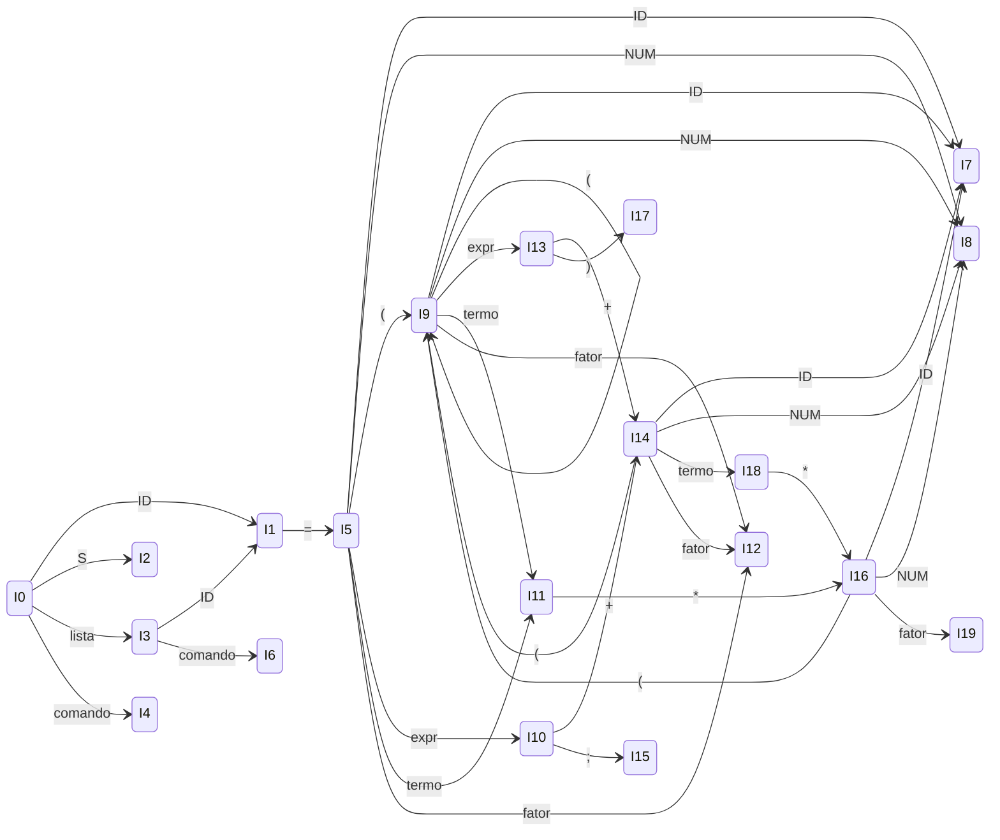
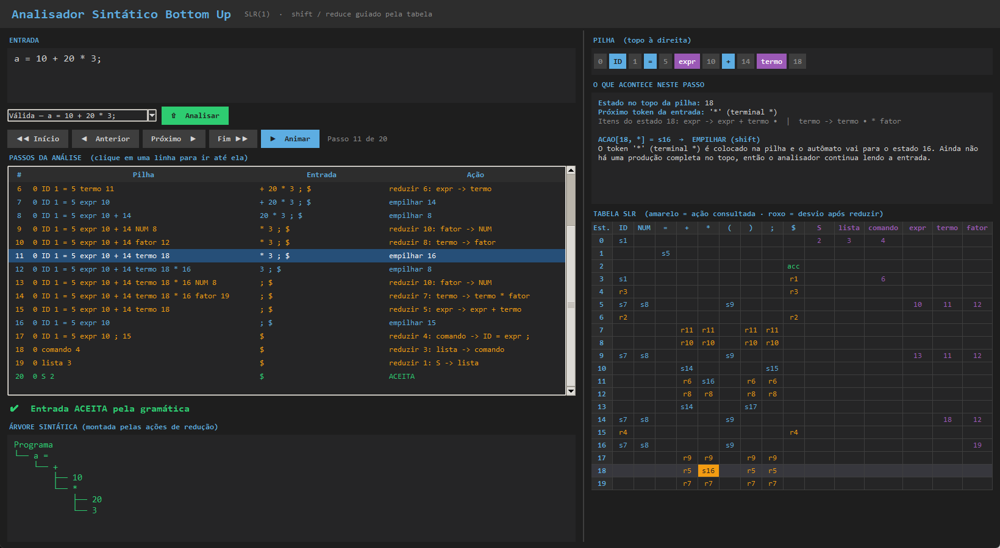

# Parte II — Análise Sintática Bottom Up (SLR)

Implementação: [parser/parser_bottom_up.py](../parser/parser_bottom_up.py)

O analisador Bottom Up recebe os tokens gerados pelo **Analisador Léxico** do CraftScript (Parte I) e verifica, usando a **tabela de análise sintática SLR**, se a entrada é aceita pela gramática.

---

## 1. Gramática utilizada

Gramática baseada na definição do trabalho, aumentada com a produção inicial `S' → S`:

| Nº | Produção |
|---|---|
| 0 | S' → S |
| 1 | S → lista |
| 2 | lista → lista comando |
| 3 | lista → comando |
| 4 | comando → **ID** **=** expr **;** |
| 5 | expr → expr **+** termo |
| 6 | expr → termo |
| 7 | termo → termo **\*** fator |
| 8 | termo → fator |
| 9 | fator → **(** expr **)** |
| 10 | fator → **NUM** |
| 11 | fator → **ID** |

**Terminais:** `ID`, `NUM`, `=`, `+`, `*`, `(`, `)`, `;`, `$` (fim da entrada)
**Não terminais:** `S'`, `S`, `lista`, `comando`, `expr`, `termo`, `fator`

### Ligação com os tokens do Analisador Léxico

| Token do Lexer (`TokenType`) | Terminal da gramática |
|---|---|
| `ID` | ID |
| `INT`, `FLOAT` | NUM |
| `ATRIB` | = |
| `MAIS` | + |
| `MULT` | * |
| `ABRE_PAR` / `FECHA_PAR` | ( / ) |
| `PONTO_VIRG` | ; |
| `EOF` | $ |

Qualquer outro token (ex.: `bloco`, `-`, `mostrar`) não pertence a esta gramática e gera erro sintático.

---

## 2. Conjuntos Primeiro e Sequência

| Não terminal | PRIMEIRO | SEQUÊNCIA (FOLLOW) |
|---|---|---|
| S' | { ID } | { $ } |
| S | { ID } | { $ } |
| lista | { ID } | { ID, $ } |
| comando | { ID } | { ID, $ } |
| expr | { (, NUM, ID } | { +, ;, ) } |
| termo | { (, NUM, ID } | { +, *, ;, ) } |
| fator | { (, NUM, ID } | { +, *, ;, ) } |

**Como foram obtidos:**

- **PRIMEIRO:** todo `comando` começa com `ID`; portanto `lista`, `S` e `S'` também começam com `ID`. `fator` começa com `(`, `NUM` ou `ID`, e como `termo → fator` e `expr → termo`, os três têm o mesmo PRIMEIRO.
- **SEQUÊNCIA:**
  - `$ ∈ SEQ(S')`, que passa para `S` e para `lista` (S → lista).
  - Em `lista → lista comando`, o PRIMEIRO(comando) = { ID } entra em SEQ(lista).
  - `comando` aparece no fim de `lista`, logo SEQ(comando) = SEQ(lista) = { ID, $ }.
  - `expr` é seguido por `;` (produção 4), `+` (produção 5) e `)` (produção 9).
  - `termo` herda SEQ(expr) e recebe `*` (produção 7).
  - `fator` herda SEQ(termo).

---

## 3. Autômato Finito Determinístico de Itens LR(0)

### Estados (conjuntos de itens)

| Estado | Itens |
|---|---|
| **I0** | S' → •S <br> S → •lista <br> lista → •lista comando <br> lista → •comando <br> comando → •ID = expr ; |
| **I1** | comando → ID •= expr ; |
| **I2** | S' → S• |
| **I3** | S → lista• <br> lista → lista •comando <br> comando → •ID = expr ; |
| **I4** | lista → comando• |
| **I5** | comando → ID = •expr ; <br> expr → •expr + termo <br> expr → •termo <br> termo → •termo * fator <br> termo → •fator <br> fator → •( expr ) <br> fator → •NUM <br> fator → •ID |
| **I6** | lista → lista comando• |
| **I7** | fator → ID• |
| **I8** | fator → NUM• |
| **I9** | fator → ( •expr ) <br> expr → •expr + termo <br> expr → •termo <br> termo → •termo * fator <br> termo → •fator <br> fator → •( expr ) <br> fator → •NUM <br> fator → •ID |
| **I10** | comando → ID = expr •; <br> expr → expr •+ termo |
| **I11** | expr → termo• <br> termo → termo •* fator |
| **I12** | termo → fator• |
| **I13** | fator → ( expr •) <br> expr → expr •+ termo |
| **I14** | expr → expr + •termo <br> termo → •termo * fator <br> termo → •fator <br> fator → •( expr ) <br> fator → •NUM <br> fator → •ID |
| **I15** | comando → ID = expr ;• |
| **I16** | termo → termo * •fator <br> fator → •( expr ) <br> fator → •NUM <br> fator → •ID |
| **I17** | fator → ( expr )• |
| **I18** | expr → expr + termo• <br> termo → termo •* fator |
| **I19** | termo → termo * fator• |

### Transições

| De | Símbolo | Para |
|---|---|---|
| I0 | ID | I1 |
| I0 | S | I2 |
| I0 | lista | I3 |
| I0 | comando | I4 |
| I1 | = | I5 |
| I3 | ID | I1 |
| I3 | comando | I6 |
| I5 / I9 / I14 / I16 | ID | I7 |
| I5 / I9 / I14 / I16 | NUM | I8 |
| I5 / I9 / I14 / I16 | ( | I9 |
| I5 | expr | I10 |
| I5 / I9 | termo | I11 |
| I5 / I9 / I14 | fator | I12 |
| I9 | expr | I13 |
| I10 | + | I14 |
| I10 | ; | I15 |
| I11 | * | I16 |
| I13 | + | I14 |
| I13 | ) | I17 |
| I14 | termo | I18 |
| I16 | fator | I19 |
| I18 | * | I16 |

### Diagrama



Estados de aceitação/redução (têm item completo `A → α•`): I2 (aceita), I3, I4, I6, I7, I8, I11, I12, I15, I17, I18, I19.

---

## 4. Tabela de Análise Sintática Bottom Up (SLR)

**Legenda:** `sN` = empilhar (shift) e ir para o estado N · `rN` = reduzir pela produção N · `acc` = aceitar · vazio = erro.

As reduções `rN` (produção `A → α`) são colocadas nas colunas dos terminais de **SEQUÊNCIA(A)**.

| Estado | ID | NUM | = | + | * | ( | ) | ; | $ | S | lista | comando | expr | termo | fator |
|---|---|---|---|---|---|---|---|---|---|---|---|---|---|---|---|
| 0 | s1 | | | | | | | | | 2 | 3 | 4 | | | |
| 1 | | | s5 | | | | | | | | | | | | |
| 2 | | | | | | | | | acc | | | | | | |
| 3 | s1 | | | | | | | | r1 | | | 6 | | | |
| 4 | r3 | | | | | | | | r3 | | | | | | |
| 5 | s7 | s8 | | | | s9 | | | | | | | 10 | 11 | 12 |
| 6 | r2 | | | | | | | | r2 | | | | | | |
| 7 | | | | r11 | r11 | | r11 | r11 | | | | | | | |
| 8 | | | | r10 | r10 | | r10 | r10 | | | | | | | |
| 9 | s7 | s8 | | | | s9 | | | | | | | 13 | 11 | 12 |
| 10 | | | | s14 | | | | s15 | | | | | | | |
| 11 | | | | r6 | s16 | | r6 | r6 | | | | | | | |
| 12 | | | | r8 | r8 | | r8 | r8 | | | | | | | |
| 13 | | | | s14 | | | s17 | | | | | | | | |
| 14 | s7 | s8 | | | | s9 | | | | | | | | 18 | 12 |
| 15 | r4 | | | | | | | | r4 | | | | | | |
| 16 | s7 | s8 | | | | s9 | | | | | | | | | 19 |
| 17 | | | | r9 | r9 | | r9 | r9 | | | | | | | |
| 18 | | | | r5 | s16 | | r5 | r5 | | | | | | | |
| 19 | | | | r7 | r7 | | r7 | r7 | | | | | | | |

A tabela não possui conflitos (nenhuma célula com duas ações), portanto a gramática é **SLR(1)**.

---

## 5. Ações do analisador (algoritmo shift/reduce)

1. A pilha começa com o estado `0`.
2. Olha o estado do topo `s` e o terminal atual `a`, e consulta `ACAO[s][a]`:
   - **sN (empilhar):** empilha `a` e o estado `N`, e avança na entrada.
   - **rN (reduzir por A → α):** desempilha `|α|` símbolos/estados, consulta `DESVIO[topo][A]` e empilha `A` e o novo estado. Nesse momento é executada a **ação semântica** da produção, que monta o nó da AST (`Assignment`, `BinaryOp`, `Literal`, `Variable`).
   - **acc:** a entrada é aceita.
   - **vazio:** erro sintático. O analisador informa quais terminais eram esperados naquele estado.

### Exemplo de execução: `a = 10 + 20 * 3;`

| Pilha | Entrada | Ação |
|---|---|---|
| 0 | a = 10 + 20 * 3 ; $ | empilhar 1 |
| 0 ID 1 | = 10 + 20 * 3 ; $ | empilhar 5 |
| 0 ID 1 = 5 | 10 + 20 * 3 ; $ | empilhar 8 |
| 0 ID 1 = 5 NUM 8 | + 20 * 3 ; $ | reduzir 10: fator → NUM |
| 0 ID 1 = 5 fator 12 | + 20 * 3 ; $ | reduzir 8: termo → fator |
| 0 ID 1 = 5 termo 11 | + 20 * 3 ; $ | reduzir 6: expr → termo |
| 0 ID 1 = 5 expr 10 | + 20 * 3 ; $ | empilhar 14 |
| 0 ID 1 = 5 expr 10 + 14 | 20 * 3 ; $ | empilhar 8 |
| 0 ID 1 = 5 expr 10 + 14 NUM 8 | * 3 ; $ | reduzir 10: fator → NUM |
| 0 ID 1 = 5 expr 10 + 14 fator 12 | * 3 ; $ | reduzir 8: termo → fator |
| 0 ID 1 = 5 expr 10 + 14 termo 18 | * 3 ; $ | empilhar 16 |
| 0 ID 1 = 5 expr 10 + 14 termo 18 * 16 | 3 ; $ | empilhar 8 |
| 0 ID 1 = 5 expr 10 + 14 termo 18 * 16 NUM 8 | ; $ | reduzir 10: fator → NUM |
| 0 ID 1 = 5 expr 10 + 14 termo 18 * 16 fator 19 | ; $ | reduzir 7: termo → termo * fator |
| 0 ID 1 = 5 expr 10 + 14 termo 18 | ; $ | reduzir 5: expr → expr + termo |
| 0 ID 1 = 5 expr 10 | ; $ | empilhar 15 |
| 0 ID 1 = 5 expr 10 ; 15 | $ | reduzir 4: comando → ID = expr ; |
| 0 comando 4 | $ | reduzir 3: lista → comando |
| 0 lista 3 | $ | reduzir 1: S → lista |
| 0 S 2 | $ | **ACEITA** |

AST gerada: `Assignment(a, BinaryOp(Literal(10), +, BinaryOp(Literal(20), *, Literal(3))))`

---

## 6. Entradas válida e inválida

**Válida** ([bottomup_valido.craft](../bottomup_valido.craft)):
```
a = 10 + 20 * 3;
b = (a + 5) * 2;
c = a * b + (10 + 2) * 3;
```
Resultado: **ACEITA**.

**Inválidas:**

| Entrada | Resultado |
|---|---|
| `a = 10 + ;` | esperado 'ID' ou 'NUM' ou '(' mas encontrou ';' |
| `a = * 20;` | esperado 'ID' ou 'NUM' ou '(' mas encontrou '*' |
| `a 10 + 20;` | esperado '=' mas encontrou '10' |
| `a = 10 + 20` | esperado '+' ou '*' ou ')' ou ';' mas encontrou fim da entrada |

A primeira está em [bottomup_invalido.craft](../bottomup_invalido.craft).

> No último caso o erro é detectado no estado 8 (`fator → NUM •`), logo após ler o `20`. Nesse estado a redução `r10` está em todos os terminais de SEQUÊNCIA(fator) = { +, *, ;, ) }; como `$` não está entre eles, a entrada é rejeitada. O `)` aparece entre os esperados porque, no SLR, a SEQUÊNCIA é calculada para a gramática toda, e não para o contexto exato da entrada.

---

## 7. Como executar

**Terminal:**
```bash
python main.py bottomup_valido.craft --bottom-up
python main.py bottomup_invalido.craft --bottom-up
```

**Interface gráfica** (`python gui.py`):
- **⇧ Análise Bottom Up:** analisa o código do editor e mostra a pilha, a entrada e a ação de cada passo, além do resultado (aceita/rejeitada) e da AST.
- **Visualizador Bottom Up:** abre uma janela que executa a análise passo a passo, desenhando a pilha, destacando na tabela SLR a célula consultada e explicando cada ação (também pode ser aberto direto com `python gui_bottom_up.py`).
- **Tabela SLR:** mostra as produções e a tabela ACAO/DESVIO usada pelo analisador.


